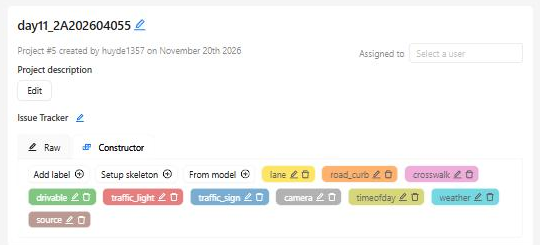
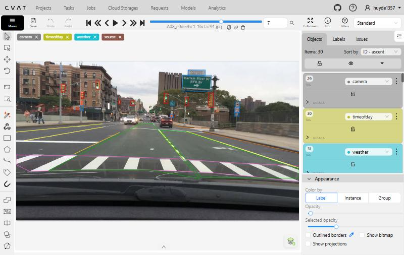
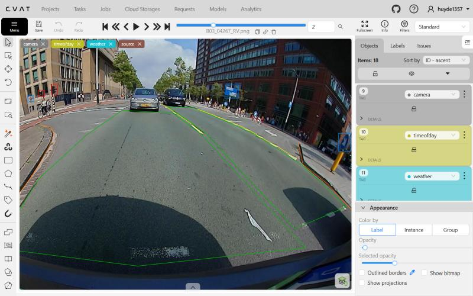
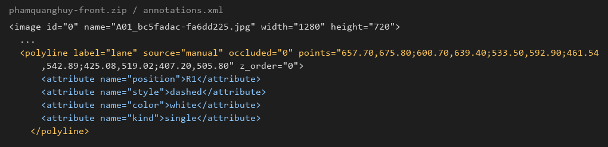

# Báo cáo cá nhân — Ngày 11

Họ tên: Phạm Quang Huy   Mã học viên: 2A202604055
Phiên bản CVAT (Help → About): 2.81.0 (CVAT chạy local)
Guideline: Road v1.0    Lần nộp : 2
Thời điểm export (ngày giờ trên CVAT): 2026-11-21 09:28 ; manifest ghi `2026-11-21T02:28:44+00:00`    Số lần nộp lại sau Rework: 1

## 1. Kiểm project
| Mục | Đúng như guideline Road v1.0? | Ghi chú |
| --- | --- | --- |
| 6 label, đúng kiểu | Có | lane, road_curb (polyline); crosswalk, drivable (polygon); traffic_light, traffic_sign (rectangle). Dán từ `configs/road_v1_labels.json` vào tab Raw |
| Thuộc tính và giá trị | Có | JSON label sinh từ `src/road_lab/taxonomy.py`; đã so `python -m road_lab.taxonomy` với file config: khớp |
| 4 tag ảnh | Có | camera, timeofday, weather, source; mỗi tag là label kiểu Tag có một thuộc tính select `value` |

Cách kết thúc polyline trên bản CVAT này: click các điểm từ gần xe ra xa, bấm phím **N** để kết thúc.
Cách đặt tag ảnh trên bản CVAT này: công cụ Tag ở thanh trái → chọn label (camera, timeofday, weather, source) → mở Details sửa `value` (CVAT tự điền giá trị đầu danh sách nên phải kiểm lại).

## 2. Số lượng đã gán
| Task | Ảnh | lane | road_curb | crosswalk | drivable | traffic_light | traffic_sign |
| --- | ---: | ---: | ---: | ---: | ---: | ---: | ---: |
| front | 12 | 33 | 10 | 4 | 26 | 26 | 31 |
| front-extra  | 4 | 13 | 3 | 2 | 8 | 13 | 16 |
| fisheye | 8 | 11 | 17 | 14 | 8 | 9 | 8 |
| fisheye-extra  | 4 | 0 | 9 | 6 | 1 | 0 | 1 |

Mọi ảnh (28/28) có đủ bốn tag; không ảnh nào chưa gán (theo manifest).

## 3. Bảng ca khó
| Ảnh | Nhãn | Phân vân giữa | Đã chọn | Lý do |
| --- | --- | --- | --- | --- |
| A05 | lane L1/R1 | vẽ vạch cho đủ / không vẽ | không vẽ | Phố hai bên xe đỗ, mặt đường không có vạch sơn. Guideline: không vẽ vạch mà ảnh không có; lint báo QC1-02, chờ coach xác nhận để miễn |
| A09, A14 | lane R1 | có R1 / không có | không vẽ R1 | Không có vạch trắng |
| A08 | lane bên trái làn | vạch trắng rõ (#5678) / vệt sơn mòn gần xe hơn | vệt sơn mòn là **L1** (dashed), #5678 là L2, #5677 là other | Tăng tương phản thấy vệt sơn trắng mòn đứt quãng sát làn của xe; nếu lấy #5678 làm L1 thì làn của xe rộng gấp hơn hai lần làn R1–R2 bên cạnh. Biên trái vùng `direct` cũng đã bám theo vệt này |
| A09 | drivable giữa vạch đôi và vạch đứt | không gán / alternative | alternative | Vạch đứt trắng chia hai làn cùng chiều; xe phía trái vạch đôi quay đầu về phía mình nên đó mới là làn ngược chiều |
| A16 | lane nằm ngang ở mép vạch ngựa vằn | lane other / không gán | không gán | Đó là mép vạch ngựa vằn, không phải vạch kẻ làn dọc; gán thành lane sẽ là vạch thừa (QC1-03) |
| A16 | timeofday | day / dusk | dusk | Trời chạng vạng, đèn đường và đèn xe đã bật |
| A02, A11 | timeofday | day / dusk (A02), dusk / night (A11) | day (A02), dusk (A11) | A02 nắng thấp nhưng trời còn sáng hẳn; A11 trời xanh sẫm, chưa tối hẳn |
| B03, B04 | lane position  | trái/phải theo xe / theo ảnh | theo ảnh | Guideline không nói rõ cho camera sau; dùng thống nhất: vạch bên trái ảnh là L, bên phải ảnh là R. B03: vạch gần R1, vạch xa R2.|
| B03 | traffic_sign  | prohibitory / information | prohibitory | Tấm trắng có vòng tròn viền đỏ = biển hạn chế theo vùng (Zone 30 / cấm đỗ); phân nhóm theo chức năng |
| B04 | drivable làn có chữ BUS | alternative / không gán | alternative | labcoach đã xác nhận |
| B06 | lane dọc đảo phân cách | solid / dashed | dashed | Các khối sơn trắng nối nhau có khe ngắn |
| B06 | vệt sơn ngắn nằm ngang (167–274, y≈252) | lane other / không gán | không gán | Các vệt nằm ngang, vuông góc với dãy vạch đứt, là vạch ngang, không phải vạch kẻ làn; điểm đầu của lane B cũng bỏ khỏi vệt này |
| B07 | dải nhựa xám giữa vạch ngựa vằn và thân xe | crosswalk / không gán | không gán | Polygon crosswalk dừng ở mép vạch trắng gần xe nhất; dải xám là mặt đường, dưới nó là thân xe |
| B03 | drivable direct khi đã có L1 | direct trải tới mép đảo bên trái / thu về L1 và gán alternative cho làn bên trái L1 | giữ nguyên direct | Chưa rõ làn bên trái L1 có cùng chiều hay không (đảo giao thông, rẽ trái), nên chưa tách alternative; **cần hỏi coach** |

## 4. Phiếu QC 1 nhận được
Bạn kiểm lô của tôi: nguyenvietminh (phiếu `nguyenvietminh-qc1-for-phamquanghuy.md`, kiểm 6 ảnh A01, A04, A08, B03, B06, B08, 91 nhãn)  Quyết định nhận được: Rework (1 lỗi nặng, 1 lỗi chính, tỉ lệ lỗi chính 1,1 %)
| Mã lỗi | Số lỗi | Đồng ý? | Đã sửa? |
| --- | ---: | --- | --- |
| QC1-02 (nặng): B03 thiếu L1 | 1 | Đồng ý. Phóng to ảnh thấy 3 vệt đứt trắng mờ ở bên trái làn, thẳng hàng về điểm tụ và đối xứng với R1 qua tâm ảnh | Đã sửa: thêm lane L1 (dashed, white, single) bám theo 3 vệt đứt, vẽ từ gần xe ra xa |
| QC1-07 (chính): B08 thiếu drivable | 1 | Đồng ý. Bảng kế hoạch B08 yêu cầu drivable + lane position=other mà ảnh chưa có polygon drivable | Đã sửa: thêm polygon drivable direct, biên là mép vỉa, mép trên vạch ngựa vằn và thân xe |

Các mã còn lại (QC1-01, 03, 04, 05, 06, 08, 09, 10, 11, 12) bạn ghi 0 lỗi. Ảnh A01 bạn kiểm không thấy lỗi. Hai nhãn mới đã đưa vào lần nộp thứ 2 (`revision` 2); bản lần 1 giữ trong thư mục `r1/`, manifest cũ đổi tên `phamquanghuy-manifest-r1.json`.

Tự kiểm trước khi đổi lô (lint, không phải phiếu của bạn kiểm): đã sửa B07 lane sai `position` (camera bên phải phải là `other`), B03 lane cùng phía mà một là L1 (đổi thành R2), A01 lane L2 bị vẽ trùng, A16 lane ngang ở mép vạch ngựa vằn, 4 polyline B03 vẽ từ xa về gần, 7 polyline fisheye chỉ 2–3 điểm, `edge_zone` ở B02 và B05; sau đó gán lại `position` cho vạch ở A06 và A08, thêm L1 (vạch sơn mòn) ở A08, xóa vạch ngang khỏi lane ở B06 và thêm vùng drivable cho B06. Lint giảm từ 21 xuống 5 cảnh báo (4 nặng đều là ảnh không có vạch, chờ coach xác nhận). Sau phiếu của bạn kiểm, tôi thêm L1 ở B03 và drivable ở B08 (lần nộp 2), lint vẫn 5 cảnh báo.

## 5. Kiểm file export
| File | Mở lại được? | Số shape ảnh 1 (job / file) | Số shape ảnh 2 (job / file) | Tag camera có trong XML? |
| --- | --- | --- | --- | --- |
| phamquanghuy-front.zip | Có (`road_check lint` đọc được 16 ảnh) | A01: 9 / 9 | A02: 7 / 7 | Có (`front`) |
| phamquanghuy-fisheye.zip | Có (12 ảnh) | B01: 8 / 8 | B02: 12 / 12 | Có (`fisheye_front`) |

Format CVAT for images 1.1, không kèm ảnh (`contains_images: false` trong manifest). Mỗi zip gộp task chính và task extra.

## 6. Ảnh chụp màn hình
1. Tab Labels của project `day11_2A202604055`: đủ 6 label vẽ và 4 label tag.

   

2. Ảnh camera trước A08 đã gán đủ: 4 tag, làn L1/L2/R1/R2, vùng lái direct và alternative, vạch ngựa vằn, đèn và biển.

   

3. Ảnh fisheye B03 (camera sau), phóng to đoạn hai vạch đứt R1 và R2 cong theo ảnh.

   

4. Đoạn XML có `<polyline label="lane">` trong `phamquanghuy-front.zip` (ảnh A01):

   

```xml
<image id="0" name="A01_bc5fadac-fa6dd225.jpg" width="1280" height="720">
  ...
  <polyline label="lane" source="manual" occluded="0" points="657.70,675.80;600.70,639.40;533.50,592.90;461.54,542.89;425.08,519.02;407.20,505.80" z_order="0">
    <attribute name="position">R1</attribute>
    <attribute name="style">dashed</attribute>
    <attribute name="color">white</attribute>
    <attribute name="kind">single</attribute>
  </polyline>
```

## 7. Tự đánh giá
Lỗi bạn mắc nhiều nhất hôm nay (theo mã QC1-xx), và cách tránh ở Ngày 20:
Lỗi tôi mắc nhiều nhất là QC1-11. Lần chạy lint đầu tiên có 9 polyline trên ảnh fisheye (B02, B03, B06, B07, B08, B11) chỉ có 2 hoặc 3 điểm, nên đường vẽ ra là các đoạn thẳng, không bám theo cung cong của ảnh. Lỗi nặng hơn là QC1-03, gặp 5 lần: gán L1 cho một vạch ở camera bên phải B07, gán L1 và R1 cho hai vạch cùng một phía ở B03, lấy nhầm vạch xa làm L1 ở A08, và hai lần vẽ vạch ngang thành lane (mép vạch ngựa vằn ở A16, các vệt sơn nằm ngang ở B06). Tôi cũng vẽ ngược chiều 4 đường ở B03 (QC1-04) vì quên rằng với camera sau, phía gần xe vẫn là đáy ảnh.

Ở Ngày 20 tôi sẽ đặt điểm cách nhau khoảng 20 đến 50 px trên ảnh fisheye, xác định làn của xe trước rồi mới đếm vạch ra hai bên để gán position, chỉ gán lane cho vạch chạy dọc theo đường, và chạy `road_check lint` sau mỗi vài ảnh để bắt lỗi sớm thay vì đợi cuối buổi.

Nhãn của bạn đi vào model ở đâu? Chọn một lỗi đã sửa và nói nó làm model học sai thế nào:
Polyline lane được chuyển thành đích cho model dò làn kiểu row-anchor: ở mỗi hàng y, đích là toạ độ x của L1 và R1. Lỗi tôi chọn là ở A08. Lúc đầu tôi gán L1 cho vạch trắng rõ nằm xa bên trái (#5678), trong khi L1 thật là một vạch sơn đã mòn nằm sát làn của xe. Nếu kéo dài #5678 xuống hàng y = 440, làn của xe rộng khoảng 1170 px, gần gấp ba làn bên phải giữa R1 và R2 (khoảng 400 px). Model học từ những nhãn như vậy sẽ đặt biên trái của làn quá xa, tính tâm làn lệch sang trái, và hệ thống giữ làn (LKA) sẽ kéo xe về phía làn bên cạnh. Tôi đã sửa bằng cách thêm L1 theo vạch mòn, đổi #5678 thành L2 và #5677 thành other.

## 8. (Tùy chọn, buffer) Từ polyline đến đích row-anchor
| y | 720 | 680 | 640 | 600 | 560 |
| --- | ---: | ---: | ---: | ---: | ---: |
| x của chúng tôi |  |  |  |  |  |
| x của bạn kia |  |  |  |  |  |

(Tùy chọn, không tính điểm. Chạy `PYTHONPATH=src python3 -m road_lab.rowanchor out/nop-bai/phamquanghuy-front.zip --image A01` để lấy số.)
